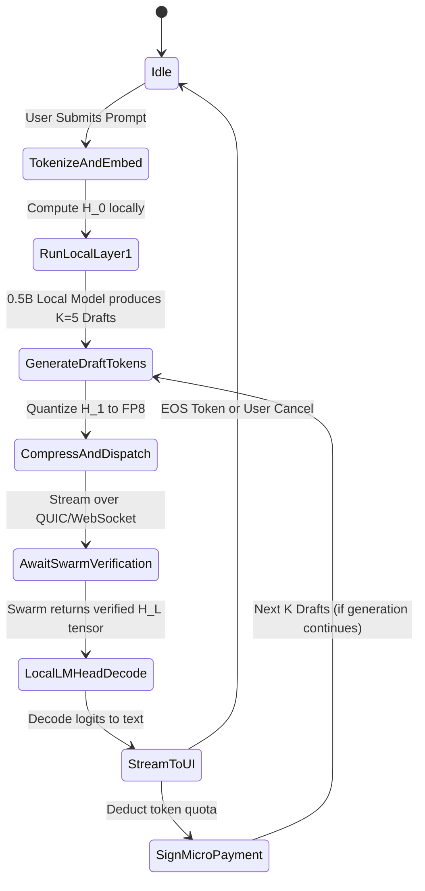

# 📱 Agent Spec 01: Client Draft & Split-Learning Agent

The **Client Draft Agent** runs directly on the end-user's device (desktop app, mobile phone, or WebGPU browser tab). It guarantees **complete user privacy** and drives **speculative token acceleration**.

---

## 🎯 1. Core Responsibilities & Objectives

1. **Local Privacy Isolation (Split-Learning):**
   * Executes local tokenization and input embedding: transforms raw user text into an abstract activation tensor $H_0 \in \mathbb{R}^{B \times S \times D}$.
   * Executes Layer 1 locally so no readable token IDs or un-scrambled embeddings ever touch the public P2P network.
   * Executes the final Normalization and LM Head ($H_L \rightarrow \text{logits}$) locally to decode output text without exposing answers to miners.
2. **Speculative Draft Generation:**
   * Runs an ultra-lightweight, quantized draft model (e.g. Llama-3.2-0.5B-Q4_K_M or BitNet 0.5B) locally.
   * Generates $K=5$ candidate tokens in $<10\text{ms}$ to send to the swarm for parallel verification.
3. **Stream Management & State Channel Signing:**
   * Manages the Server-Sent Events (SSE) stream for rendering incoming tokens to the UI.
   * Signs micro-payment debit vouchers per verified token block using an Ed25519 cryptographic keypair.

---

## ⚙️ 2. Internal State Machine & Architecture



---

## 📥 3. Input / Output Interface

### Inputs
* **User Prompt (`string`):** Raw user input text.
* **Sampling Parameters (`JSON`):** `temperature`, `top_p`, `max_tokens`, `stop_sequences`.
* **Swarm Output Tensor (`FP8 / Float16`):** The final hidden state $H_{L-1}$ returned by the last pipeline node.

### Outputs
* **Dispatch Payload (to Swarm Pod):**
  ```json
  {
    "request_id": "req_8f3d1a9b",
    "pod_id": "pod_eu_central_01",
    "prompt_h1_tensor": "<base64_encoded_fp8_vector>",
    "draft_tokens": [1542, 882, 319, 4521, 992],
    "client_signature": "0x4b7e88...",
    "state_channel_nonce": 1042
  }
  ```
* **Decoded Text Stream (to User):** Streaming characters via WebSocket / SSE.

---

## 🛡️ 4. Creative & Critical Edge Case Handling

| Edge Case | Failure Mode | Autonomous Agent Action |
| :--- | :--- | :--- |
| **Low-End Client (0.5B Draft model too slow)** | Draft model takes $>30\text{ms}$ on old phone CPU. | **Auto-Bypass:** Disable local draft model; switch to streaming single-token activation $H_1$ directly to the swarm. |
| **Swarm Rejects All Draft Tokens** | Swarm verifier rejects all $K=5$ tokens ($0\%$ acceptance). | **Adaptive $K$ Reduction:** Dynamically lower draft count $K$ from $5 \rightarrow 3 \rightarrow 1$ to prevent wasted swarm compute. |
| **Swarm Latency Spike (>300ms)** | Current Swarm Pod experiences congestion or node dropout. | **Pod Failover:** Ping Coordinator Agent to migrate request to a hot backup Geo-Pod within $150\text{ms}$. |
| **Client Runs Out of Fuel Credits** | Token wallet reaches 0 mid-stream. | **Graceful Truncation:** Finish current sentence gracefully, pause stream, and display *"Recharge or Seed Compute to continue"* modal. |

---

## 💻 5. Python Implementation Template

```python
import torch
from dataclasses import dataclass
from typing import List, Tuple

@dataclass
class DraftBatch:
    draft_tokens: List[int]
    hidden_activation_fp8: bytes
    request_id: str

class ClientDraftAgent:
    def __init__(self, draft_model, tokenizer, device="cpu"):
        self.draft_model = draft_model  # e.g., Llama-3.2-0.5B quantized
        self.tokenizer = tokenizer
        self.device = device
        self.k_speculative = 5

    def process_prompt_privacy_isolated(self, prompt: str) -> Tuple[torch.Tensor, List[int]]:
        """1. Tokenize & embed locally (Never send raw text to network)"""
        input_ids = self.tokenizer.encode(prompt, return_tensors="pt").to(self.device)
        
        # Local Embedding + Layer 1
        with torch.no_grad():
            embeddings = self.draft_model.model.embed_tokens(input_ids)
            h1 = self.draft_model.model.layers[0](embeddings)[0]
            
            # Generate K draft tokens locally
            draft_tokens = self._generate_draft_k(input_ids, k=self.k_speculative)
            
        return h1, draft_tokens

    def decode_final_logits(self, swarm_output_tensor: torch.Tensor) -> str:
        """Execute Final LM Head locally to decode text"""
        with torch.no_grad():
            normed = self.draft_model.model.norm(swarm_output_tensor)
            logits = self.draft_model.lm_head(normed)
            next_token_id = torch.argmax(logits[:, -1, :], dim=-1).item()
            return self.tokenizer.decode([next_token_id])
```
