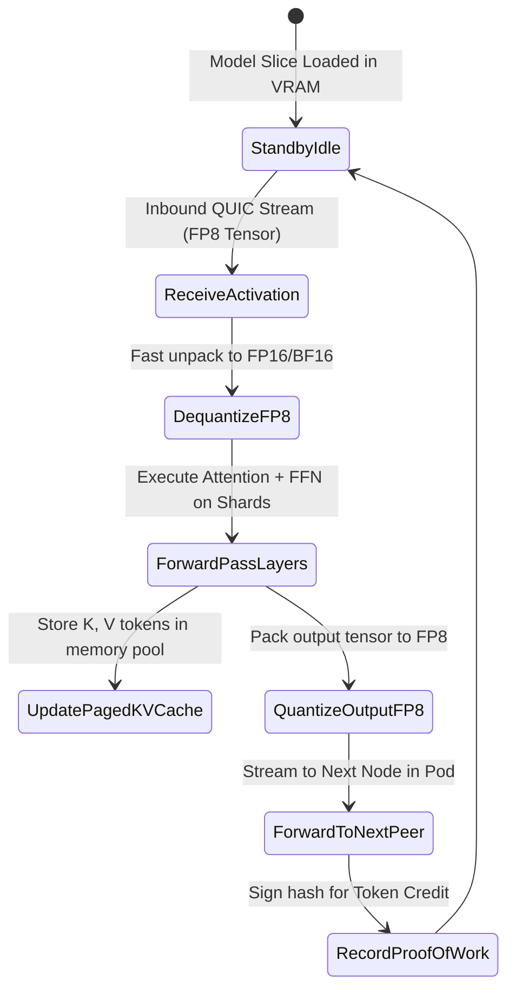

# ⚡ Agent Spec 03: Layer Miner & Hot-Standby Agent

The **Layer Miner Agent** is the foundational compute workhorse of the AirCompute mesh. It runs on consumer laptops, gaming rigs, M-series Macs, or office desktops, hosting a quantized slice of model layers and executing lightning-fast forward-pass matrix multiplications.

---

## 🎯 1. Core Responsibilities & Objectives

1. **Quantized Layer Execution:**
   * Loads assigned model layers (e.g. Layers 20–39 of Llama-3.3-70B) in 4-bit AWQ, GGUF, or BitNet 1.58b format into local RAM/VRAM.
   * Executes Transformer attention and feedforward blocks with zero unnecessary memory copies.
2. **Paged KV-Cache Management:**
   * Maintains persistent Key-Value caches for concurrent user streams using **Paged KV** buffers to prevent VRAM fragmentation.
3. **Hot-Standby Shadow Mode:**
   * When acting as a standby node, receives parallel activation streams and updates local KV caches in the background so it can take over as primary in $<50\text{ms}$ if the primary crashes.
4. **Thermal & Battery Protection:**
   * Monitors device battery level, CPU/GPU temperatures, and user input activity. Automatically throttles or sheds load if the user starts active work/gaming on their device.

---

## ⚙️ 2. Execution Pipeline & State Machine



---

## 📥 3. Input / Output Interface

### Inputs (Inbound Stream from Preceding Peer)
* **Tensor Payload (`Binary FP8`):** Hidden state $H_{\text{in}} \in \mathbb{R}^{B \times S \times D}$.
* **Request Metadata (`Header`):** `request_id`, `layer_start`, `layer_end`, `session_token_count`.

### Outputs (Outbound Stream to Subsequent Peer)
* **Tensor Payload (`Binary FP8`):** Transformed hidden state $H_{\text{out}} \in \mathbb{R}^{B \times S \times D}$.
* **Execution Receipt (to Trap Verifier / Coordinator):**
  ```json
  {
    "request_id": "req_8f3d1a9b",
    "miner_peer_id": "12D3KooW...",
    "layer_range": [20, 39],
    "activation_hash": "sha256:9c1a7d2e...",
    "execution_time_ms": 4.1,
    "timestamp_epoch": 1786291201
  }
  ```

---

## 🛡️ 4. Creative & Critical Edge Case Handling

| Critical Scenario | System Risk | Miner Autonomous Reaction |
| :--- | :--- | :--- |
| **User Starts Gaming / Unplugs Laptop** | Device gets hot, battery drains fast, game lags. | **Instant Graceful Step-Down:** Immediately triggers standby promotion signal to Coordinator, flushes KV cache, and transitions to low-power sleep mode within $80\text{ms}$. |
| **VRAM Exhaustion (Too Many Concurrent Streams)** | System crashes with CUDA/Metal Out-Of-Memory (OOM). | **Paged KV Offloading:** Evicts oldest idle session KV-blocks to system RAM; refuses new streams and signals load percentage to Coordinator. |
| **Network Packet Loss on Inbound Activation** | Corrupted tensor values cause output text garbling. | **CRC32 Checksum Validation:** Verifies activation packet integrity; requests fast UDP packet retransmission if checksum fails. |

---

## 💻 5. High-Throughput Layer Execution Kernel

```python
import torch
import numpy as np

class LayerMinerAgent:
    def __init__(self, layer_modules: list, device="cuda"):
        self.layers = layer_modules
        self.device = device
        self.paged_kv_cache = {}  # session_id -> (K, V)

    def process_incoming_activation(self, fp8_bytes: bytes, session_id: str) -> bytes:
        """1. Zero-copy dequantize FP8 -> FP16"""
        h_in = self._dequantize_fp8_to_fp16(fp8_bytes).to(self.device)
        
        # 2. Retrieve session KV Cache
        past_kv = self.paged_kv_cache.get(session_id, None)
        
        # 3. Execute Transformer forward pass through assigned layer slice
        h_out = h_in
        new_kvs = []
        with torch.no_grad():
            for i, layer in enumerate(self.layers):
                layer_kv = past_kv[i] if past_kv else None
                h_out, updated_kv = layer(h_out, past_key_value=layer_kv)
                new_kvs.append(updated_kv)
                
        # 4. Save updated KV Cache
        self.paged_kv_cache[session_id] = new_kvs
        
        # 5. Quantize output tensor back to FP8 for network transmission
        return self._quantize_fp16_to_fp8(h_out)

    def _quantize_fp16_to_fp8(self, tensor: torch.Tensor) -> bytes:
        """Quantizes activation tensor into E4M3/E5M2 FP8 format"""
        scale = tensor.abs().max() / 448.0
        fp8_tensor = (tensor / scale).to(torch.float8_e4m3fn)
        return fp8_tensor.cpu().numpy().tobytes()
```
