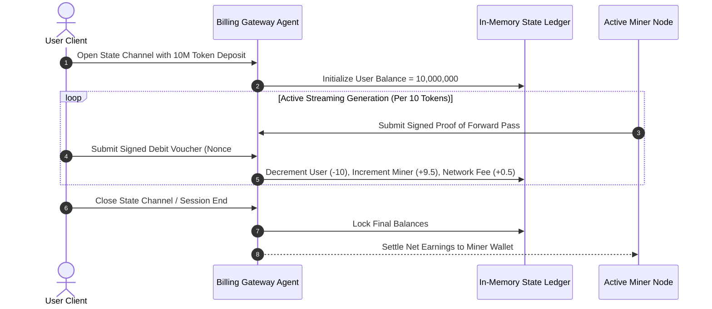

# 💳 Agent Spec 06: Ledger & State-Channel Billing Agent

The **Ledger & Billing Agent** handles sub-millisecond, gas-free micro-payments and manages the **Prosumer Fuel Credit Economy** of the AirCompute mesh.

---

## 🎯 1. Core Responsibilities & Objectives

1. **State Channel Micropayments (Zero Gas Fees):**
   * Processes cryptographically signed off-chain balance vouchers (Ed25519) per token batch generated.
2. **Prosumer Credit Balancing:**
   * Automatically credits "AI Fuel Units" when a device seeds compute during idle hours.
   * Debits fuel units when the user queries the network for inference.
3. **Prepaid Telecom-Style "Data Pack" Management:**
   * Manages fiat/UPI/crypto recharge packages (e.g. ₹50 / $1 $\rightarrow$ 10,000,000 tokens) with real-time balance tracking in high-speed in-memory store (Redis).
4. **Automated Batch Settlement:**
   * Periodically aggregates thousands of off-chain payment channel transactions and commits the net balances to a layer-1/layer-2 ledger (Solana, Base, or local state DB).

---

## ⚙️ 2. State Channel Micro-Billing Lifecycle



---

## 📥 3. Input / Output Interface

### Inputs
* **Debit Voucher (`JSON`):** Signed message authorizing deduction of tokens.
  ```json
  {
    "channel_id": "chan_9921a",
    "nonce": 421,
    "user_public_key": "0x3f8a91...",
    "tokens_consumed": 150,
    "user_signature": "0x89e21f..."
  }
  ```

### Outputs
* **Balance Update & Stream Authorization (`WebSocket`):** Real-time `ALLOW` or `INSUFFICIENT_FUNDS` response sent to the Swarm Router.

---

## 🛡️ 4. Creative & Critical Edge Case Handling

| Critical Scenario | System Risk | Ledger Autonomous Reaction |
| :--- | :--- | :--- |
| **Double-Spending Attack (User sends same signed voucher to 2 pods)** | User attempts to consume compute twice on 1 balance. | **Strict Monotonic Nonces:** Every voucher must increment an integer nonce; any replay of a previous nonce or branching nonce is rejected in $<0.5\text{ms}$. |
| **User Disconnects Mid-Stream without Settling Voucher** | Miner does compute but user vanishes before signing final voucher. | **Micro-Escrow Buffer:** 500 tokens are pre-locked in micro-escrow before each streaming chunk begins; released to miner if user disconnects abruptly. |
| **Fiat Recharge Webhook Delay (UPI/Card takes 5 seconds)** | User paid for recharge but tokens are delayed. | **Instant Optimistic Credit:** Grants immediate temporary credit upon bank transaction initiation; finalizes once webhook clears. |

---

## 💻 5. State Channel Verification Engine

```python
from cryptography.hazmat.primitives.asymmetric.ed25519 import Ed25519PublicKey
import json

class LedgerBillingAgent:
    def __init__(self, redis_client):
        self.redis = redis_client

    def process_micro_debit(self, voucher_json: dict) -> bool:
        """Verifies Ed25519 signature and debits in-memory token ledger"""
        user_pubkey_hex = voucher_json['user_public_key']
        signature_bytes = bytes.fromhex(voucher_json['user_signature'])
        
        # 1. Reconstruct message
        msg_payload = f"{voucher_json['channel_id']}:{voucher_json['nonce']}:{voucher_json['tokens_consumed']}"
        
        # 2. Verify Cryptographic Signature
        try:
            pubkey = Ed25519PublicKey.from_public_bytes(bytes.fromhex(user_pubkey_hex))
            pubkey.verify(signature_bytes, msg_payload.encode('utf-8'))
        except Exception:
            print("🚨 INVALID SIGNATURE: Rejecting debit voucher.")
            return False

        # 3. Check and update balance atomically
        user_key = f"user:{user_pubkey_hex}:balance"
        current_bal = int(self.redis.get(user_key) or 0)
        tokens_due = voucher_json['tokens_consumed']
        
        if current_bal < tokens_due:
            print("🚨 INSUFFICIENT FUEL CREDITS: Pausing stream.")
            return False
            
        self.redis.decrby(user_key, tokens_due)
        return True
```
