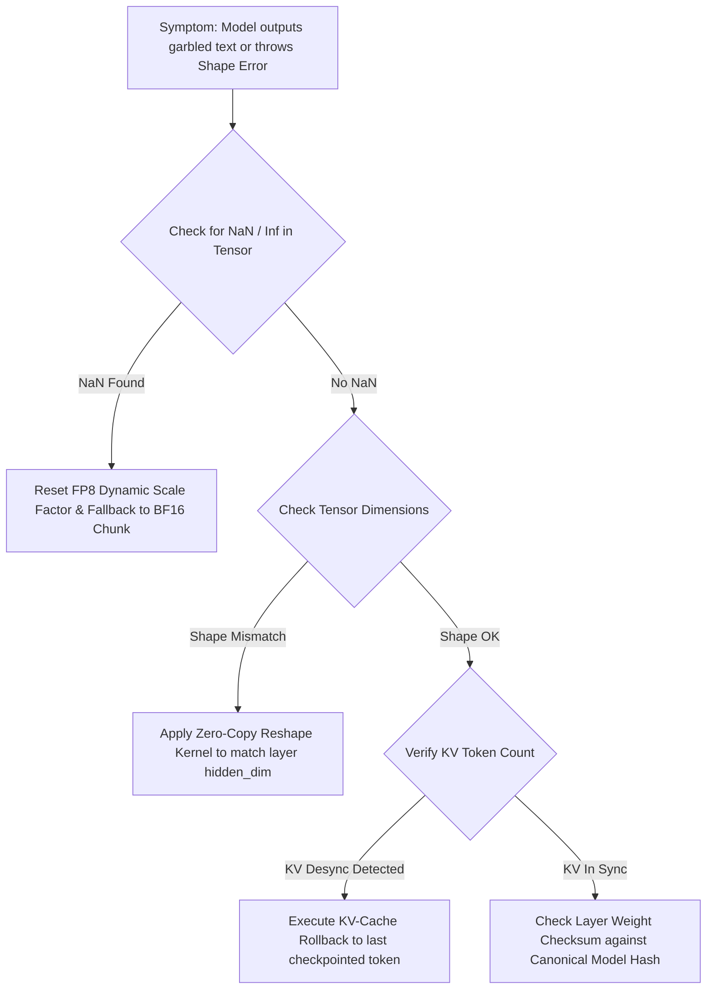

# 🔍 Debug Playbook 02: Tensor Mismatch & KV-Cache Desynchronization

This playbook provides root-cause diagnosis for tensor shape collisions, FP8 dequantization NaN values, and KV-cache drift across distributed layers.

---

## 🚨 1. Error Symptom Matrix

| Error Code | Error Signature | Root Cause | Automated Resolution |
| :--- | :--- | :--- | :--- |
| `ERR_TENSOR_SHAPE_COLLISION` | `Expected shape [1, 5, 4096], received [1, 1, 4096]` | Speculative batch mismatch between draft agent and target shard. | **Auto-Reshape Adapter:** Inspect header metadata; expand batch dimension or request client resend draft vector. |
| `ERR_FP8_NAN_EXPLOSION` | `Activation tensor contains NaN / Inf values` | FP8 dynamic scaling factor underflow/overflow during quantization. | **Scale Clipping & Fallback:** Clamp FP8 scaling factor to $[10^{-4}, 448.0]$; fallback to BF16 for high-magnitude layers. |
| `ERR_KV_CACHE_DESYNC` | `KV Cache token count (42) != Stream prompt tokens (45)` | Lost intermediate activation frame or missed rollback after speculative reject. | **KV Cache Rollback:** Revert KV buffer pointer to last verified token index; re-inject missing prompt prefix. |

---

## 🛠️ 2. Automated Diagnostic Decision Tree

