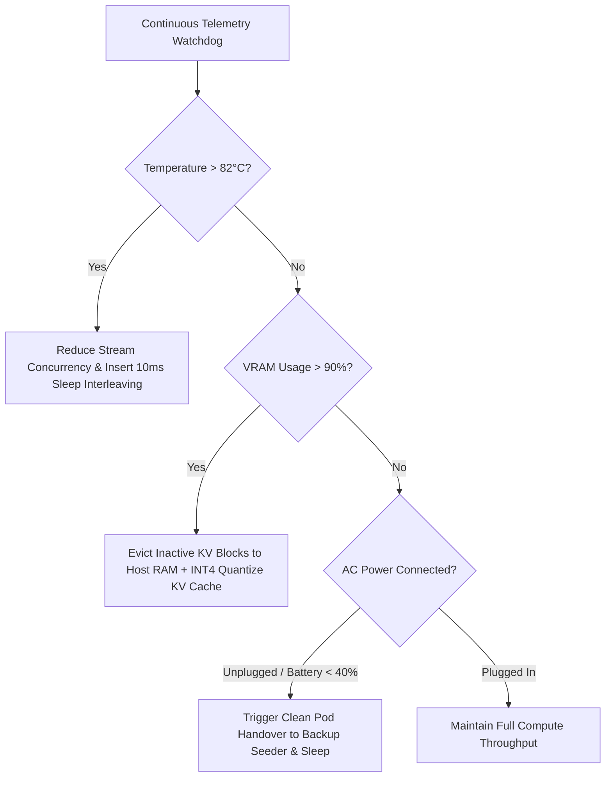

# 🔍 Debug Playbook 03: Edge OOM, Thermal Throttling & Power Management

This playbook details how consumer devices (laptops, MacBooks, office PCs) autonomously handle memory pressure, thermal limits, and battery conservation.

---

## 🚨 1. Error Symptom Matrix

| Error Code | Error Signature | Root Cause | Automated Resolution |
| :--- | :--- | :--- | :--- |
| `ERR_CUDA_METAL_OOM` | `CUDA out of memory / MPS alloc failed` | Too many active concurrent session KV-caches in VRAM. | **Paged KV Eviction:** Offload least-recently-used KV blocks to system RAM; activate 4-bit KV quantization. |
| `ERR_THERMAL_THROTTLE` | `SoC temperature exceeded 85°C` | Heavy continuous matrix multiplication on consumer laptop. | **Duty-Cycle Throttling:** Insert $10\text{ms}$ cooling sleep intervals between forward passes; offload 50% layers to Standby. |
| `ERR_BATTERY_DISCHARGE` | `Device running on battery power (<40%)` | User unplugged charging cable from laptop. | **Graceful Handover:** Complete current token batch, broadcast handover to Coordinator, and pause seeder worker. |

---

## 🛠️ 2. Memory & Thermal Guard Decision Tree

