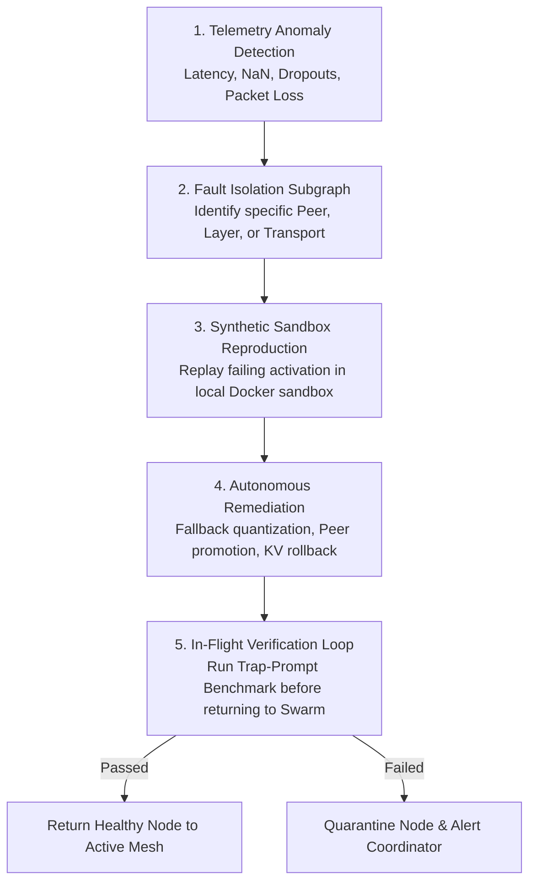

# 🔄 Debug Playbook 05: Autonomous Root Cause Analysis (RCA) & Healing Loop

This document outlines the **5-step closed-loop autonomous self-healing engine** that detects, isolates, reproduces, patches, and verifies any runtime failure in the AirCompute mesh without requiring manual human developer intervention.

---

## ⚙️ 1. The 5-Stage Autonomous Self-Healing Cycle

---

## 🛠️ 2. Autonomous RCA Protocol Details

1. **Stage 1: Anomaly Telemetry Ingestion**
   * Real-time metrics streaming: Inter-Token Latency (ITL), FP8 Dynamic Range, Loss Rate, Memory Utilization.
2. **Stage 2: Graph-Based Fault Localization**
   * Uses bi-directional tracing to locate which node in the $N$-hop pipeline caused the breakdown.
3. **Stage 3: Automated Sandbox Replay**
   * Replays the exact input activation tensor in an isolated memory buffer to confirm if error is hardware-dependent (e.g. GPU bit-flip) or software-dependent.
4. **Stage 4: Automated Policy Execution**
   * Promotes Hot-Standby twin, downsizes batch dimension, or applies INT4 KV-compression automatically.
5. **Stage 5: Verification & Swarm Re-Integration**
   * Executes 3 deterministic test vectors; if all pass, unlocks the node to process paying user traffic again.
