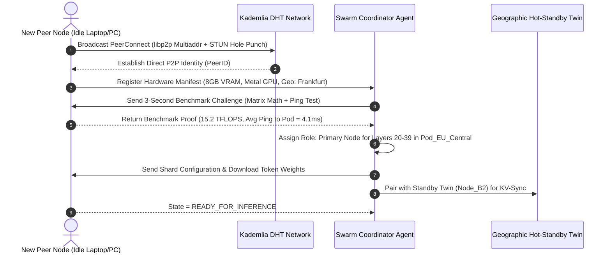

# 🔄 Workflow 01: Peer Discovery & Geo-Pod Setup

This workflow details how idle consumer and enterprise devices join the AirCompute mesh, undergo automated capability benchmarking, and get clustered into sub-$10\text{ms}$ latency **Geo-Pods**.

---

## 🎯 1. Workflow Objectives & Lifecycle

1. **Bootstrap & NAT Traversal:** Peer nodes connect to the Kademlia DHT via bootstrap relays, performing STUN/TURN hole-punching.
2. **Hardware & Latency Benchmark:** The coordinator runs a 3-second diagnostic to measure VRAM, FLOPS, and network ping.
3. **Shard Layer Assignment:** The node receives its assigned model shard (e.g. Layers 20–39 of Llama-3.3-70B or MoE Experts 1–16).
4. **Hot-Standby Pairing:** The node is paired with a geographic twin node for high-availability backup.

---

## ⚙️ 2. Step-by-Step State Machine

---

## 🛡️ 3. Edge Cases & Creative Fallback Logic

| Edge Case | Failure Mode | Autonomous Recovery Action |
| :--- | :--- | :--- |
| **Symmetric Firewall (Port Closed)** | Direct inbound UDP/QUIC packets dropped. | **Relay Proxy Escalation:** Route through an open UPnP / STUN relay node with WebRTC transport encapsulation. |
| **Node Has Insufficient VRAM for Full Shard** | Device only has 3GB free VRAM instead of 4GB. | **Sub-Quantization Fallback:** Downscale model slice from 4-bit AWQ to 2.5-bit / 2-bit GGUF or BitNet 1.58b to fit cleanly into 2.5GB. |
| **Node High Ping (>40ms to local Pod)** | Node internet connection is lagging. | **Relocate to Outer Geo-Pod:** Reassign node to a wider, asynchronous batch-processing Pod rather than a real-time interactive chat Pod. |
