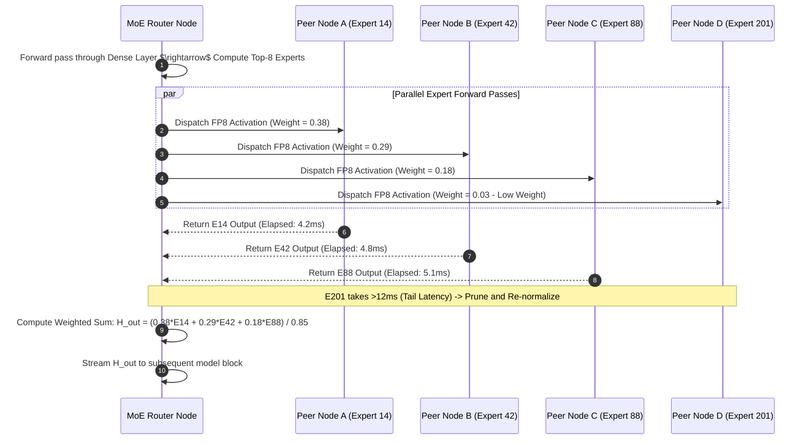

# 🔀 Workflow 03: MoE Dynamic Expert Routing

This workflow outlines how giant Sparse Mixture-of-Experts models (like **DeepSeek-V3 671B**) are executed across hundreds of consumer devices without overloading network bandwidth.

---

## 🎯 1. Workflow Architecture & Objectives

1. **Gate Evaluation:** Computes gating router logits $G(x) = \text{Softmax}(\text{TopK}(x \cdot W_g))$.
2. **Targeted Dispatch:** Routes activations asynchronously **only to the Top-8 active expert nodes**.
3. **Tail-Latency Pruning:** Drops slow outlier experts with low weight ($<0.04$) to guarantee consistent streaming latency.
4. **Weighted Aggregation:** Recombines expert activations into the final layer output tensor.

---

## ⚙️ 2. Dynamic MoE Sparse Routing Diagram

---

## 🛡️ 3. Hot-Expert Auto-Replication Mechanism

If a specific expert (e.g. Expert #42 for Python coding) receives $>15\%$ of all global tokens:
1. The MoE Router notifies the Swarm Coordinator.
2. The Coordinator instructs 5 nearby idle nodes to clone and load Expert #42's 2.5GB weights.
3. Subsequent requests to Expert #42 are load-balanced across the 5 replicas, eliminating bottlenecks.
