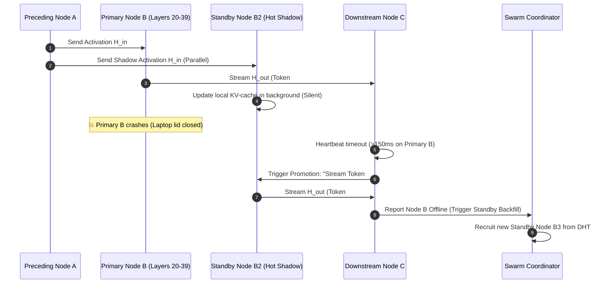

# 🛡️ Workflow 04: Hot-Standby & Self-Healing Failover

This workflow guarantees **zero-interruption generation** even when consumer nodes shut down their laptops, unplug power, or lose Wi-Fi mid-stream.

---

## 🎯 1. Workflow Architecture & Objectives

1. **Shadow Dual-Streaming:** Inbound activations are transmitted to both the **Primary Miner** and its **Hot-Standby Twin** simultaneously.
2. **Sub-150ms Heartbeat Watchdog:** Downstream nodes monitor incoming token streams; if the primary misses a frame for $>150\text{ms}$, it triggers instant failover.
3. **Zero-KV-Loss Hot Swap:** The Standby node promotes to Primary and streams the next token chunk without recomputing historical context.
4. **Dynamic Standby Backfill:** The Coordinator immediately recruits a new idle peer to take over the vacant Standby role.

---

## ⚙️ 2. Failover Sequence Diagram

---

## 🛡️ 3. Failure Mode Matrix

| Failure Event | Detection Time | Recovery Mechanism | User Impact |
| :--- | :--- | :--- | :--- |
| **Primary Miner Drops** | $<150\text{ms}$ | Standby Shadow Promotion | **Zero visible lag** (<0.2s pause) |
| **Both Primary & Standby Drop Simultaneously** | $<300\text{ms}$ | Migrate entire Pod slice to Adjacent Geo-Pod with Paged KV replication | 0.5s pause in streaming |
| **Coordinator Disconnects** | $<500\text{ms}$ | Raft/Paxos consensus elects next nearest node as Sub-Coordinator | **Zero disruption** (Mesh is decentralized) |
