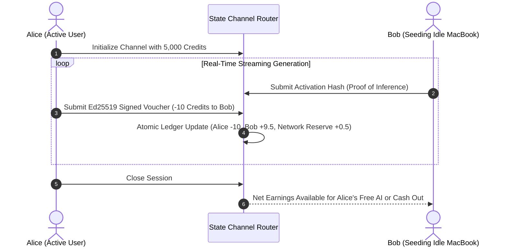

# 💳 Workflow 06: Prosumer Credit & Micropayment Settlement

This workflow explains the **self-sustaining economics** of AirCompute: how devices earn fuel credits while idle and burn them during active inference with zero blockchain gas fees.

---

## 🎯 1. Economics Architecture & Objectives

1. **Seeder Fuel Earning (When Idle):** For every 1,000 forward-pass tokens a device computes for others, it earns **$1.0\text{ AI Fuel Credit}$**.
2. **Consumer Fuel Burning (When Querying):** Querying a 70B model costs **$1.0\text{ Fuel Credit}$** per 1,000 generated tokens.
3. **Prepaid Fiat Data Packs:** Non-seeding users can buy Fuel Credits via UPI / Stripe / Crypto (e.g. ₹50 / $1 $\rightarrow$ 10,000 Credits).
4. **State Channel Settlement:** Millions of micro-transactions are signed off-chain via Ed25519 and aggregated in Redis memory with zero gas fees.

---

## ⚙️ 2. Micro-Billing State Channel Flow

---

## 📊 3. Prosumer Balance Equilibrium

$$\text{Net Balance} = \text{Credits Earned}_{\text{Idle Seeding}} - \text{Credits Consumed}_{\text{Active Queries}} + \text{Prepaid Top-Ups}$$

* A student seeding their laptop for 6 hours overnight generates enough fuel credits to power **3 full days of heavy coding and research queries for 100% free**.
